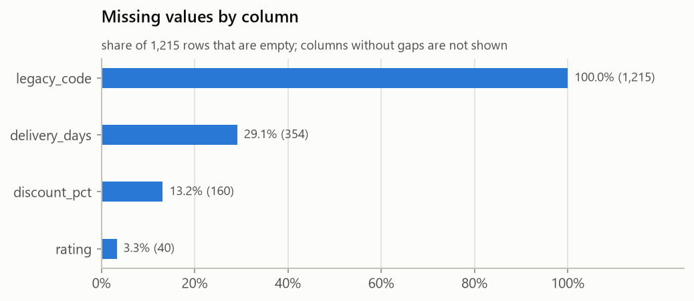
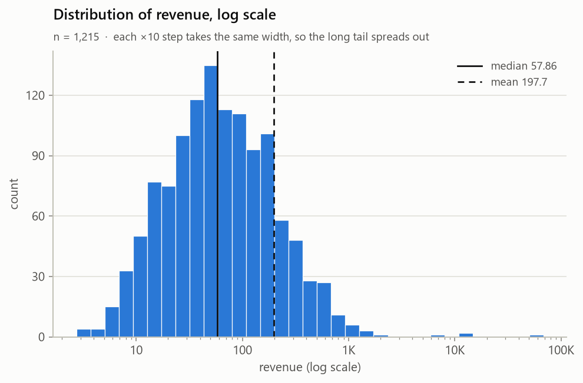

# Python Data Analyst: an agent skill for exploratory data analysis

[](https://github.com/GrowingRui/PythonDataAnalyst/actions/workflows/tests.yml)
[](LICENSE)

Ask your AI agent *"What's wrong with the data in sales.csv?"* and get a careful
analyst's answer, backed by tested code: data quality problems, descriptive
statistics, correlations, charts and a written report. Your file is never
changed: cleaning happens only when you approve it, on a copy, with a log of
every change.

The skill works on CSV, TSV, Excel, Parquet and JSON files with pandas, NumPy,
Matplotlib and Seaborn. The agent runs scripts that compute every number, then reads the
results and the charts and writes the interpretation.

It's written in the open [Agent Skills](https://agentskills.io/) format, so it
works in Claude Code (as a plugin or a plain skill) and in other agents that
support skills, such as OpenAI Codex, Gemini CLI, GitHub Copilot or Cursor.

<p>
  
  
</p>

## Contents

- [What it does](#what-it-does)
- [Install](#install)
- [Use it](#use-it)
- [What you get](#what-you-get)
- [Try it on the sample data](#try-it-on-the-sample-data)
- [How it works](#how-it-works)
- [Methods and limitations](#methods-and-limitations)
- [Development](#development)
- [License](#license)

## What it does

- **Loads messy files robustly:** detects the delimiter, falls back from
  UTF-8 to Windows-1252, picks Excel sheets, flattens nested JSON into
  `parent.child` columns and explains clearly when a file can't be read
  (including JSON that isn't a table, with the paths where records were found).
- **Checks data quality:**
  - missing values, including placeholders such as `-` or `unknown`
  - exact duplicates and repeated keys
  - numbers or dates stored as text, mixed types, lists inside cells
  - inconsistent labels (`North` / `north `)
  - IQR outliers, and numeric codes such as `999`
- **Describes the data:** statistics per column type, skewness, top
  categories.
- **Finds relationships:** Pearson and Spearman correlations, with a warning
  when they disagree.
- **Compares groups against one target** (`--target revenue`, `--target
  churned`): medians or class rates per group, every column ranked by one
  0–1 strength, groups too small to compare marked, and columns that
  predict the target suspiciously well flagged as possible leakage.
- **Follows dates over time:** rows per day, week, month, quarter or year
  (chosen automatically), with gaps that are unlikely to be chance, spikes,
  incomplete first and last periods, and future or placeholder dates
  (`1900-01-01`). Dates stored as text are parsed in memory only.
- **Draws charts:** histograms with box plots, log-scale histograms for skewed
  data, top categories, a missing-values chart, a time trend, a correlation
  heatmap, scatter plots of the strongest pairs, and box plots or rate charts
  per group for a target. They use one consistent,
  colourblind-checked palette.
- **Writes a report:** `report.md` with ranked findings, cleaning options and
  what each one costs, suggested next steps and limitations. `summary.json`
  holds the same facts in machine-readable form.
- **Never changes your data.** Problems are flagged, not fixed. The agent
  proposes cleaning steps with their consequences and waits for your
  approval.
- **Cleans only what you approved, reproducibly:** approved steps go into a
  `plan.json` from a fixed set of 12 tested steps (drop duplicates, turn
  placeholders into missing values, convert numbers and dates stored as
  text, relabel, fill or drop missing values, cap or flag outliers, ...). A
  dry run shows every change first; `--apply` writes a **new** file with a
  change log, and the EDA is re-run on it to show which findings went away.

## Install

You need Python 3.11 or newer with pandas, NumPy, Matplotlib and Seaborn
(plus openpyxl for Excel and pyarrow for Parquet files), and an agent that can
run shell commands.

### Claude Code: install as a plugin (recommended)

In Claude Code in a terminal, run:

```text
/plugin marketplace add GrowingRui/PythonDataAnalyst
/plugin install python-data-analyst@growingrui-data-skills
```

On Claude Code 2.1.275 or later, one line does both:
`/plugin install python-data-analyst --marketplace GrowingRui/PythonDataAnalyst`.
Updates arrive through `/plugin`, like any other plugin. Until it's used, the
skill costs about 110 tokens per session (its one-line description).

**Using the VS Code extension?** `/plugin` isn't available in its chat
("/plugin isn't available in this environment"). Install from a terminal
instead. The extension shares the same settings, so the plugin shows up there
in the next new chat:

```bash
claude plugin marketplace add GrowingRui/PythonDataAnalyst
claude plugin install python-data-analyst@growingrui-data-skills
```

If `claude` isn't on your PATH, put `npx @anthropic-ai/claude-code` in front
instead (for example `npx @anthropic-ai/claude-code plugin install ...`). To
update or remove it later, use `claude plugin update` or
`claude plugin uninstall` with the same name.

### Any agent: copy the skill folder

The skill is the single folder `skills/python-data-analyst/`. Copy it into
the folder where your agent looks for skills:

| Agent | Project folder | User folder (all projects) |
|---|---|---|
| Claude Code (without the plugin) | `.claude/skills/` | `~/.claude/skills/` |
| Agents that use the shared convention | `.agents/skills/` | `~/.agents/skills/` |
| Any other agent | see its documentation for "skills" | |

```bash
# macOS / Linux: install into a project
git clone https://github.com/GrowingRui/PythonDataAnalyst.git
mkdir -p /path/to/your-project/.agents/skills
cp -r PythonDataAnalyst/skills/python-data-analyst /path/to/your-project/.agents/skills/
```

```powershell
# Windows PowerShell: install for your user (all projects)
git clone https://github.com/GrowingRui/PythonDataAnalyst.git
New-Item -ItemType Directory -Force "$HOME\.agents\skills" | Out-Null
Copy-Item -Recurse PythonDataAnalyst\skills\python-data-analyst "$HOME\.agents\skills\"
```

Skill folders differ between agents and change over time, so check your
agent's documentation if the skill doesn't show up. The community
[`skills` installer](https://github.com/vercel-labs/skills) can also copy it
for many agents at once (`npx skills add GrowingRui/PythonDataAnalyst`); it's a
third-party tool and isn't tested by this project.

**No skill support?** Point the agent at `skills/python-data-analyst/SKILL.md`
and ask it to follow it. Agents that read `AGENTS.md` do this by themselves
inside this repository.

### Python packages

Install them in the environment the agent will use. A project virtual
environment (`.venv`) is picked up automatically.

```bash
pip install "pandas>=2.1" "numpy>=1.26" "matplotlib>=3.8" "seaborn>=0.13" "openpyxl>=3.1" "pyarrow>=14"
```

openpyxl is only needed for Excel files and pyarrow only for Parquet files;
leave out the one you don't use.

If a package is missing, the skill tells the agent to ask you before
installing anything.

## Use it

Start a new agent session in your project and ask in plain language:

- *"Explore `data/sales.csv` and tell me what stands out."*
- *"Check `customers.xlsx` (sheet `2025`) for data quality problems."*
- *"Which numeric columns in `survey.csv` have outliers, and should I remove them?"*
- *"Profile `events.parquet` before I build a dashboard on it."*

Or call the skill by name, with an optional focus. In Claude Code that's
`/python-data-analyst:python-data-analyst` when installed as a plugin, or
`/python-data-analyst` when copied as a plain skill:

```text
/python-data-analyst:python-data-analyst data/sales.csv focus on regional revenue differences
```

You can also run the scripts yourself, without an agent:

```bash
python skills/python-data-analyst/scripts/inspect_data.py data/sales.csv         # quick text summary
python skills/python-data-analyst/scripts/inspect_data.py data/sales.csv --json  # the same as JSON
python skills/python-data-analyst/scripts/generate_eda.py data/sales.csv         # full report + charts
python skills/python-data-analyst/scripts/clean_data.py data/sales.csv --plan plan.json          # dry run
python skills/python-data-analyst/scripts/clean_data.py data/sales.csv --plan plan.json --apply  # write a cleaned copy
python skills/python-data-analyst/scripts/compare_runs.py eda_output/before eda_output/after     # what changed
```

| Option | Script | Purpose |
|---|---|---|
| `--sheet NAME` | both | Excel sheet to read (default: the first) |
| `--json-path KEYS` | both | Where the records are in a `.json` file, e.g. `data.orders` for `{"data": {"orders": [...]}}` |
| `--encoding ENC` | both | Force a text encoding (CSV, JSON), e.g. `latin-1` |
| `--delimiter ";"` | both | Force a delimiter when detection guesses wrong |
| `--key COLS` | both | Columns that should be unique, e.g. `order_id`; also checks for repeated keys |
| `--top N` | inspect | Top values shown per categorical column |
| `--output DIR` | EDA | Output folder (default `eda_output/<file>_<timestamp>/`, must be new or empty) |
| `--max-categories N` | EDA | Top-N categories per chart; the rest become "Other" |
| `--max-scatter-points N` | EDA | Random sample size for scatter plots on large data |
| `--max-charts N` | EDA | Cap on the number of charts (default 40) |
| `--date-column COL` | EDA | Date column for the time trend (default: the one with the most dates) |
| `--period P` | EDA | `day`, `week`, `month`, `quarter` or `year` for the time trend (default: about 12–120 points) |
| `--target COL` | EDA | Compare one column across all the others (adds report section 4b) |

`clean_data.py` takes the same reading options (`--sheet`, `--json-path`,
`--encoding`, `--delimiter`) plus `--plan FILE` (required), `--apply` (write;
without it nothing is written), `--output FILE` (`.csv` or `.parquet` in a new
or empty folder; default `eda_output/<file>_cleaned_<timestamp>/`), `--json`
and `--list-steps`.

## What you get

```text
eda_output/sales_20261105-092532/
├── report.md       # the report: read this first
├── summary.json    # every computed fact, plus the ranked findings
└── charts/
    ├── 01_missing_values.png
    ├── 02_time_order_date_by_week.png
    ├── 03_correlation_heatmap.png
    └── ...
```

`report.md` always has the same seven sections:

1. **Dataset overview**: file, size, column types
2. **Data quality assessment**: missing values, duplicates, type problems, outliers
3. **Descriptive statistics**: numeric, true/false, date and categorical columns
4. **Key findings**: ranked rule-based findings, then the agent's *Analyst interpretation*
5. **Visualization summaries**: one or two sentences per chart, with the chart
6. **Suggested next steps**: cleaning options with their costs, further analysis
7. **Limitations**: what the methods used can't tell you

With `--target`, a section **4b. Target comparison** follows the key findings.

An excerpt of the findings for the sample data:

> 1. **[high] 15 rows repeat a key on `order_id` (1.2%).** These rows share a
>    key that should be unique; where they differ in other columns it isn't
>    clear which version is correct.
> 2. **[high] 1 column is completely empty: `legacy_code`.**
> 3. **[medium] `order_date` holds dates stored as text.** 1215 of 1215 text
>    values (100.0%) parse as dates; values look day-first.

The input file's SHA-256 fingerprint is recorded before the run and checked
after it, so the report itself shows that the data wasn't modified.

After an approved cleaning run, the cleaned file's folder holds:

```text
eda_output/sales_cleaned_20261105-101500/
├── sales_cleaned.csv    # the cleaned copy (or .parquet)
├── cleaning_log.md      # every step: rows, missing cells and values before/after, examples, warnings
└── cleaning_log.json    # the same, with both SHA-256 fingerprints and the plan, to rebuild the file exactly
```

## Try it on the sample data

`sample_data/sample_sales.csv` is a synthetic, deliberately messy dataset of
1,215 orders. The problems planted in it are listed at the top of
[`sample_data/make_sample_data.py`](sample_data/make_sample_data.py), so you
can check what the skill finds against the answer key.

```bash
python skills/python-data-analyst/scripts/generate_eda.py sample_data/sample_sales.csv --key order_id
```

Or ask your agent: *"What's wrong with the data in
sample_data/sample_sales.csv?"*

To see the target comparison, add `--target revenue`: `category` comes out
far ahead of `region`, `channel` makes no difference, and `order_size` is
flagged as possible leakage (it's a band computed from revenue itself).

To try the cleaning cycle, [`sample_data/cleaning_plan.json`](sample_data/cleaning_plan.json)
fixes the planted errors and nothing else (missing discounts, skew, the
time gap and the leaky column are left alone: they aren't errors to edit
away):

```bash
python skills/python-data-analyst/scripts/clean_data.py sample_data/sample_sales.csv --plan sample_data/cleaning_plan.json
```

Add `--apply` to write the copy (1,200 rows instead of 1,215, 15 columns),
then run the EDA on it and `compare_runs.py` on the two output folders: 15
findings go away, and one is new (`rating` now has 130 missing values, the
cost of turning `-` into a real missing value).

## How it works

```text
skills/python-data-analyst/     # the whole skill: this folder is what gets installed
├── SKILL.md                    # instructions the agent follows: workflow and rules
├── scripts/
│   ├── inspect_data.py         # loading, column types, statistics, quality checks
│   ├── generate_eda.py         # correlations, categories, charts; writes the output folder
│   ├── time_trends.py          # rows per period, gaps, spikes, implausible dates
│   ├── target_analysis.py      # --target: groups, strengths, leakage
│   ├── report.py               # rule-based findings and report.md
│   ├── clean_data.py           # approved cleaning steps: dry run, new file, change log
│   └── compare_runs.py         # findings gone / new / changed between two EDA runs
└── references/                 # loaded only when needed
    ├── pandas-guide.md         # reading tricky files, groupby, memory, pandas pitfalls
    ├── data-cleaning.md        # options per problem and what each one costs
    └── visualization-guide.md  # which chart answers which question, trends, misleading charts
```

The design follows a few rules:

- **The scripts compute the facts and the agent interprets them.** Every
  number comes from tested code, never from the agent estimating. The interpretation is
  written for your goal and dataset.
- **Read-only by default.** Removing outliers or filling gaps changes the
  results, so every cleaning step needs an explanation and your agreement.
  Approved steps run from a plan through tested code, never over the
  original, and the same plan on the same file always gives the same bytes.
- **Progressive disclosure.** The agent reads `SKILL.md` when the skill is used,
  and the reference guides only when a question calls for them.
- **Few dependencies.** Only pandas, NumPy, Matplotlib and Seaborn, plus
  openpyxl for Excel and pyarrow for Parquet.
- **Agent-neutral.** `SKILL.md` uses only the standard fields of the Agent
  Skills format, and the folder works on its own after a plain copy. The
  `.claude-plugin/` files only add the Claude Code plugin install.

## Methods and limitations

| Method | What it tells you | What it can't |
|---|---|---|
| IQR outliers (Q1 − 1.5·IQR, Q3 + 1.5·IQR) | Which values are unusual | Whether they're wrong. On skewed data many legitimate values are flagged |
| Pearson correlation | Straight-line relationships | Curved relationships; very sensitive to a few extreme points |
| Spearman correlation | Any steadily rising or falling relationship | U-shaped relationships |
| Skewness (adjusted Fisher–Pearson) | Whether a few large or small values pull the mean | The cause |
| Column type detection | numeric / boolean / datetime / categorical / free text, by rules | It can misclassify; the report shows the result for every column |
| Placeholder detection | A fixed list (`-`, `?`, `n/a`, `unknown`, ...) and numeric codes like `999` that are outliers | Codes inside the normal range (`0` meaning "no answer") |
| Parquet's stored types | Typed columns can't hold numbers or dates as text, so fewer type problems are found | That the values are right: the report says why type problems are absent |
| JSON flattening | Nested objects become `parent.child` columns; lists are counted and reported | The items inside lists: they aren't analysed or charted |
| Target comparison (`--target`) | How the target differs across groups (η on ranks, Cramér's V) and numeric columns; columns that predict it almost perfectly | Why: no significance tests, and another column can create a difference (Simpson's paradox). Groups under 30 rows aren't compared |
| Cleaning steps (`clean_data.py`) | Exactly what changed: rows, values and missing cells per step, with examples | Whether a change was right: filling shrinks the spread, capping changes means and totals, dropping rows can bias the sample. That's why each step needs your agreement |
| Time trend (rows per period) | When rows are missing, bunched up or misdated, for one date column | Forecasts; seasonality from less than two years of data. Gaps and spikes assume rows arrive at a steady random rate |

Correlations are computed between numeric columns only, and none of them
shows cause and effect. Severity labels on findings mean *how much this could
distort an analysis if ignored*, not *how much it matters for your question*.
That judgement is the Analyst interpretation's job.

## Development

```bash
git clone https://github.com/GrowingRui/PythonDataAnalyst.git
cd PythonDataAnalyst
python -m venv .venv
source .venv/bin/activate          # Windows: .venv\Scripts\activate
pip install -r requirements-dev.txt
python -m pytest
```

The test suite covers:
- loading and quality checks against known answers,
- the same sample data as CSV, Parquet, JSON and JSON Lines giving the same findings,
- the charts and the report,
- every Python example in the reference guides,
- an end-to-end run on the sample data that must find every planted problem
  and leave the input file byte-for-byte unchanged,
- the skill format: standard fields only, no agent-specific features, and a
  copied skill folder that runs on its own.

Separately, [`evals/`](evals/README.md) holds trigger tests: 24 prompts that
check the skill loads when it should and stays out of unrelated requests. They
run real Claude Code sessions, so they cost usage and aren't part of CI. Run
them with `python evals/run_triggers.py` after changing the skill's
description.

To use your working copy in Claude Code while you develop, add this repository
as a local marketplace (`/plugin marketplace add ./`) and install the plugin
from it; edits take effect after `/reload-plugins`.

On every push, GitHub Actions runs the tests:
- on Python 3.11 and 3.12 (Linux) and 3.12 (Windows),
- with the oldest supported versions (pandas 2.1, NumPy 1.26,
  Matplotlib 3.8),
- and through the official validators for the skill format (`skills-ref`) and
  the Claude Code plugin (`claude plugin validate`).

To change the sample data, edit `sample_data/make_sample_data.py`, run it,
and commit the regenerated CSV. A test checks that the two match.

## License

[MIT](LICENSE) © 2026 GrowingRui
